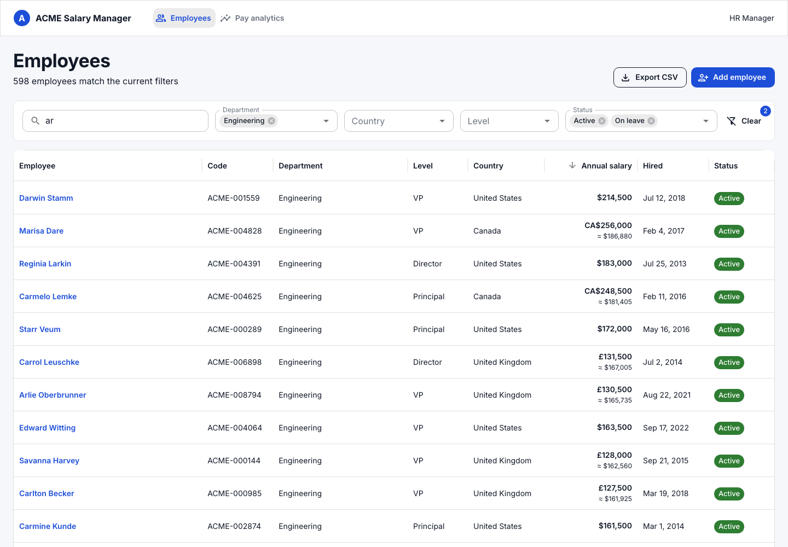
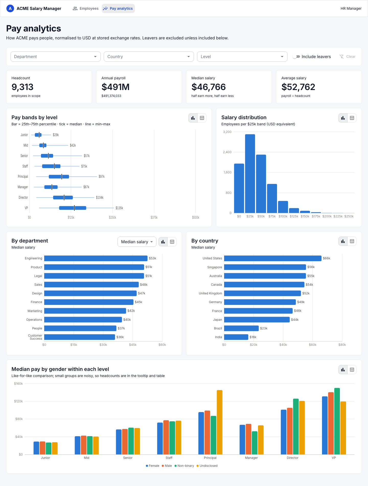

# ACME Salary Manager

Web-based salary management for an organisation of 10,000 employees across 10 countries, built for the HR manager who today lives in spreadsheets. Search and manage every employee's salary history, and answer "how does ACME pay people?" from live data normalised to USD.

**Stack:** Ruby on Rails 8 (API-only) · GraphQL (graphql-ruby) · PostgreSQL · React 19 + TypeScript · Apollo Client 4 · MUI 9 · Recharts · RSpec · Vitest.

| Directory | Pay analytics |
|---|---|
|  |  |

## Documents

| File | What it covers |
|---|---|
| [docs/REQUIREMENTS.md](docs/REQUIREMENTS.md) | One-page requirements: persona, goals, scope, what was deliberately left out and why |
| [docs/ARCHITECTURE.md](docs/ARCHITECTURE.md) | System shape, data model, request flow, module layout |
| [docs/DECISIONS.md](docs/DECISIONS.md) | Design decisions and trade-offs (append-only salary history, offset pagination, USD normalisation, …) |
| [docs/PERFORMANCE.md](docs/PERFORMANCE.md) | Measurements at 10k employees, indexes, query plans |
| [docs/AI_USAGE.md](docs/AI_USAGE.md) | How AI tooling was used, the prompts, and where it was wrong |
| [docs/PLAN.md](docs/PLAN.md) | The build plan the commit history follows |

## Features

- **Employee directory**: free-text search (name, email, code), filters by department / country / level / status, sortable columns including salary normalised to USD, server-side pagination over 10k rows. The view state lives in the URL, so it is shareable.
- **Employee profile**: current salary with USD equivalent, profile details, full salary history with period-over-period change.
- **Salary adjustment**: append-only. A change closes the current period and opens a new one with an effective date, reason and note. History is never overwritten.
- **Create / edit employee**, including the opening salary in the employee's local currency; leavers are recorded with a last day, never deleted.
- **Pay analytics**: headcount, payroll, median and average; pay bands by level (min / p25 / median / p75 / max); salary distribution; ranked comparison by department and country with a metric selector; median pay by gender within each level. Every chart has a tooltip and a table view. Filterable, with leavers excluded by default.
- **CSV export** of exactly what is on screen, with a USD column.
- **Seed data**: 10,000 deterministic, realistic employees with ~55,000 salary periods, loaded in about 4 seconds.

## Running locally

Prerequisites: Ruby 3.3, Node 22, PostgreSQL 14+ running locally.

```bash
# API (http://localhost:3000, GraphiQL at /graphiql)
cd api
bundle install
bin/rails db:create db:migrate db:seed      # seeds 10,000 employees
bin/rails server

# Web (http://localhost:5173, proxies /graphql and /exports to :3000)
cd web
npm install
npm run dev
```

If port 3000 is taken: `bin/rails server -p 3001` and `VITE_API_PROXY=http://localhost:3001 npm run dev`.

### One command, production build

```bash
docker compose up --build        # http://localhost:3000, seeds on first boot
```

The image builds the React app and has Rails serve it alongside the API, so there is one process to deploy.

## Tests

```bash
cd api && bundle exec rspec        # 71 examples: models, services, query objects, GraphQL, requests, seed generator
cd web && npm test                 # 26 tests: formatting, URL state, validation, components with mocked Apollo
cd web && npm run typecheck
```

Both suites are deterministic (seeded Faker, no network, no sleeps) and run in a few seconds.

## Deployment

`render.yaml` is a Render Blueprint: a Docker web service plus a free Postgres instance, with `SEED_ON_BOOT=1` so the demo data loads on the first start. Any platform that runs a Dockerfile and provides `DATABASE_URL` and `SECRET_KEY_BASE` works the same way (Fly.io, Railway, ECS). The container runs `db:prepare` on boot.

## Regenerating GraphQL types

The web app's TypeScript types are generated from the schema:

```bash
cd api && bin/rails graphql:schema:dump     # writes web/schema.graphql
cd web && npm run codegen                   # writes web/src/gql/
```

## Project layout

```
api/   Rails API: app/graphql (schema), app/services (use cases), app/queries (search + analytics SQL),
       lib/acme (reference data, seed generator), spec/
web/   React app: src/features/{employees,analytics}, src/components, src/lib, src/gql (generated)
docs/  Requirements, architecture, decisions, performance, AI usage, screenshots
```
