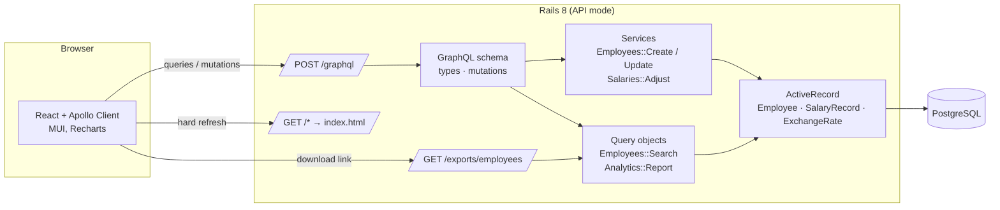
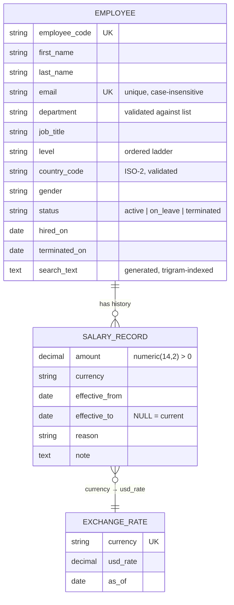

# Architecture

## Shape

One deployable unit. In production Rails serves both the GraphQL API and the built React single-page app; in development Vite's dev server proxies API paths to Rails.



## Data model



Key invariants, enforced in the database rather than only in Ruby:

- **One current salary per employee**: partial unique index on `salary_records(employee_id) WHERE effective_to IS NULL`.
- **Positive amounts and ordered periods**: check constraints.
- **Unique code and email** (email case-insensitively via an expression index).

Reference data that changes rarely (countries + currencies, departments, levels, salary reasons) lives in code (`lib/acme/countries.rb`, model constants) and is exposed to the UI through the `filterOptions` query, so there is one source of truth for validations, seeds and dropdowns.

## Request flow

**Directory page.** The URL holds search/filter/sort/page. The page builds variables for the `employees` query; `Types::QueryType#employees` constructs an `Employees::Search`, which returns a filtered relation joined to the current salary row and its exchange rate. Sorting by salary orders on `amount * usd_rate` in SQL so mixed currencies order correctly. The page type eager-loads `current_salary`, and the salary type looks up rates once per request via the GraphQL context, so a page of 100 rows costs three queries.

**Salary adjustment.** `Mutations::AdjustSalary` → `Salaries::Adjust`. Inside a transaction with the employee row locked: validate the new period starts after the current one, close the current record the day before, insert the new one. The mutation returns `{ salaryRecord, employee, errors }`; `errors` is a list of `{ path, message }` that the dialog maps onto its fields.

**Analytics.** `Analytics::Report` reuses `Employees::Search#relation` for filtering and runs one aggregate statement per requested field (`percentile_cont` for medians and quartiles, `floor()` buckets for the histogram). GraphQL resolves the fields lazily, so the client pays only for what it asks for.

**CSV export.** A plain REST endpoint that accepts the same filter/sort vocabulary and walks the sorted relation in 1,000-row pages.

## Module layout

```
api/app/graphql/        schema, types, enums, inputs, mutations (thin: argument mapping + payloads)
api/app/services/       use cases returning Result(record, errors)
api/app/queries/        Employees::Search, Analytics::Report (all SQL lives here or in models)
api/app/models/         validations, scopes, small helpers
api/lib/acme/           countries reference data; seed generator + bulk loader
api/spec/               model, service, query, graphql, request and seed specs

web/src/features/employees/   directory page, filters, table, profile, dialogs, URL-state hook, GraphQL documents
web/src/features/analytics/   dashboard page, filters, chart components, palette, URL-state hook
web/src/components/           layout, page header, status chip, error alert
web/src/lib/                  formatting + error helpers (pure, unit-tested)
web/src/gql/                  generated TypedDocumentNodes and types (do not edit)
```

## Testing strategy

- **Models**: validations and database-level invariants (including the partial unique index).
- **Services**: every business rule in `Salaries::Adjust` (ordering, append-only, currency default, failure leaves data untouched).
- **Query objects**: filters, every sort key, pagination, N+1 guard (query-count matcher), analytics math with hand-checkable numbers.
- **GraphQL**: executed directly against the schema (fast), plus one HTTP request spec for the controller and one for the CSV export and SPA fallback.
- **Seed generator**: determinism, validity, one open record per employee, contiguous periods.
- **Web**: pure helpers (formatting, URL round-trip, validation, pivots) and component tests with Apollo's `MockedProvider` for the salary-history table and the adjust-salary dialog, including server-error mapping.
